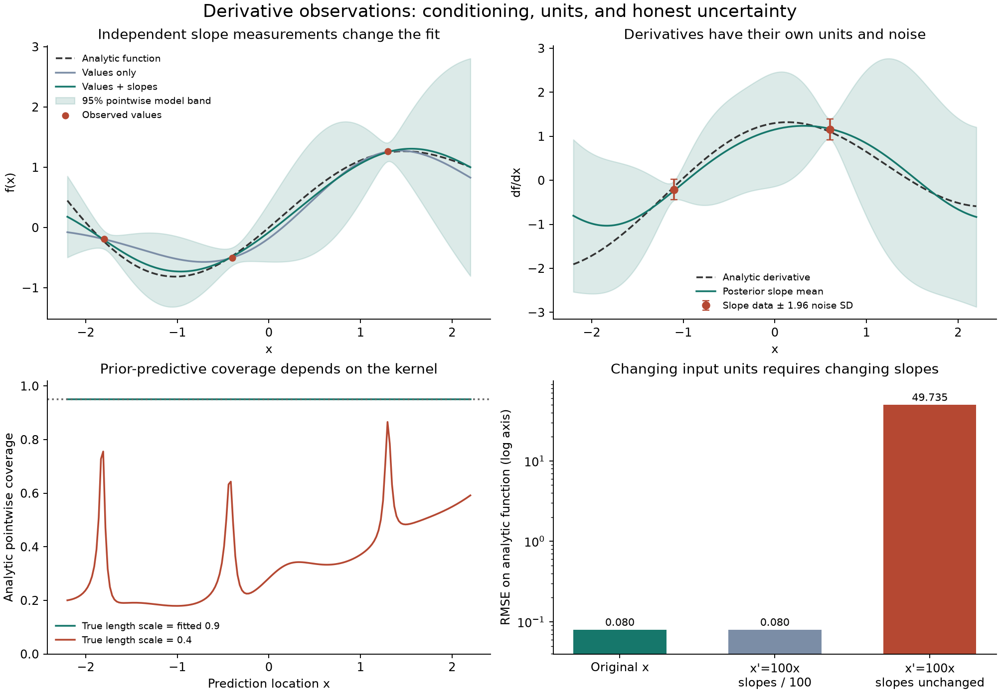

# Derivative observation GP

[](https://github.com/lcx0731/derivative-observation-gp/actions/workflows/ci.yml)

A small Gaussian process implementation that learns from both **function values
and first derivatives**, with explicit units, independent measurement noise,
replicate handling, and model-sensitive uncertainty checks.

The central question is not just whether slopes improve a fit. It is whether
the derivative covariance is correct, whether changing input units preserves
the prediction, and what a narrow posterior band actually guarantees.

All data are synthetic. The fit example uses a stated analytic function and
fixed observation offsets. A separate coverage experiment integrates exactly
under specified Gaussian laws, using floating-point linear algebra; it does not
estimate coverage by Monte Carlo or claim coverage for the analytic function.



## Reproduce

Python 3.11 or 3.13:

```bash
python3 -m venv .venv
source .venv/bin/activate
python -m pip install -r requirements-repro.txt
python -m pip install --no-deps .
python -m pip check
python -m pytest -q
python -m derivative_gp.demo --output results
derivative-gp results/example.json
```

NumPy and SciPy are runtime dependencies. Matplotlib and pytest are required
only for the demo figure and tests. `requirements-repro.txt` pins the complete
test/plot environment. There are no external data downloads. GitHub Actions
runs the tests, full demo, and installed command on both Python versions.

The demo writes `results/summary.json`, `results/example.json`, and
`results/derivative-gp.png`. It uses no random sampling. Floating-point summaries
may differ in their last bits across BLAS libraries/platforms; plots can differ
with rendering versions. Seeded randomized inputs occur only in reference tests.

## Use the library

```python
from derivative_gp import Kernel, Observation, Query, predict

observations = [
    Observation(x=-1, order=0, value=0.2, noise_std=0.1),
    Observation(x=0.3, order=1, value=-0.2, noise_std=0.04),
    Observation(x=1, order=0, value=0.5, noise_std=0.1),
]
prediction = predict(observations, [Query(0, 0), Query(0, 1)],
                     Kernel(amplitude=1.2, length_scale=0.7))
print(prediction.mean)
print(prediction.variance)  # latent function/derivative variances
print(prediction.diagnostics)
```

`order=0` means f(x), and `order=1` means df/dx. Noise is a **standard deviation**
in the corresponding measurement's units. Amplitude is the prior standard
deviation of f, not its variance. The model has a zero prior mean. Kernel and
noise parameters are supplied explicitly and held fixed; no optimizer fits them.

The Python API returns the full latent covariance and a matrix `weights` mapping
the **fused** measurements to the posterior mean. The CLI returns means, latent
variances, and diagnostics, using this strict JSON schema:

```json
{
  "kernel": {"amplitude": 1.2, "length_scale": 0.7},
  "observations": [
    {"x": -1, "order": 0, "value": 0.2, "noise_std": 0.1},
    {"x": 0.3, "order": 1, "value": -0.2, "noise_std": 0.04}
  ],
  "queries": [{"x": 0, "order": 0}, {"x": 0, "order": 1}]
}
```

The kernel object is optional, defaulting to amplitude=length_scale=1. Individual
kernel fields may also be omitted. All observation/query fields shown are
required. Unknown and duplicate keys, booleans as numbers, and nonfinite input
are rejected. The CLI reads its input without modifying it and writes JSON to
stdout. Exit codes: 0 success, 1 invalid input/numerical failure, 2 usage error.

## Covariance and conditioning

With `r=(x-z)/ell` and `b=amplitude² exp(-r²/2)`, the four covariance blocks are:

| Left observation | Right observation | Covariance |
|---|---|---|
| f(x) | f(z) | b |
| f(x) | f′(z) | b r / ell |
| f′(x) | f(z) | −b r / ell |
| f′(x) | f′(z) | b (1−r²) / ell² |

The cross-block signs differ because differentiation acts on different kernel
arguments. At a common point, value and slope have covariance zero, while slope
variance is `amplitude²/ell²`. This is ordinary joint Gaussian conditioning
with differentiated kernels, as described in
[Gaussian Processes for Machine Learning, §9.4](https://gaussianprocess.org/gpml/chapters/RW9.pdf).

Let A=K_oo+diag(noise_std²), B=K_oq, C=K_qq. The posterior is
`mean=Bᵀ A⁻¹ y`, `covariance=C−Bᵀ A⁻¹ B`. The implementation uses triangular
solves, not an explicit inverse. These are the standard fixed-parameter GP
regression equations; see
[GPML, Chapter 2](https://gaussianprocess.org/gpml/chapters/RW2.pdf).

Before Cholesky, A is scaled to a correlation matrix using
`D=diag(sqrt(diag(A)))`. Solving `D⁻¹ A D⁻¹` avoids a numerical condition
diagnostic dominated solely by the different units of f and f′. Its smallest
eigenvalue and condition number are reported. A nonpositive eigenvalue, condition
number above 1e12, or failed factorization is a numerical error. The code never
adds unreported diagonal noise or automatically changes the model to make it fit.

The returned full covariance is symmetrized but not projected onto the PSD cone.
Float64 cancellation can leave tiny negative variances/eigenvalues. A diagonal
below −1e−9 times its prior variance is rejected; smaller negative diagonals are
counted in diagnostics and clipped only in the separate `variance` summary.
These checks are diagnostics, not certified error bounds.

## Replicates and input units

Repeated measurements with exactly equal `(x, order)` and known independent
Gaussian errors are fused before conditioning. For positive standard deviations
s_i, the sufficient measurement is

```text
y_bar = sum(y_i / s_i²) / sum(1 / s_i²)
s_bar² = 1 / sum(1 / s_i²)
```

The code rescales the precision weights by the smallest s_i for numerical
stability. This preserves conditional predictions with fixed noise parameters;
it does not preserve the original-data likelihood for learning those parameters.
An exact measurement (s=0) determines that latent quantity, so additional noisy
replicates carry no further information about the function conditional on it.
Equal exact replicates collapse. Contradictory exact replicates are rejected.
Nearby but unequal coordinates remain distinct and can trigger an ill-conditioning
error. No approximate coordinate matching or pseudocount noise is used.

For a positive change of units `x_new=a*x`, correct conversion requires
`ell_new=a*ell`, slope values divided by a, and slope noise standard deviations
divided by a. Value measurements stay the same. Query slopes and their
covariances transform with the same factors. Tests check both the mean and
full covariance, as well as invariance of the scaled condition number.

Repeating an existing data row does **not** create an independent measurement.
Likewise, finite-difference slopes computed from the same noisy function values
are not independent extra derivative observations: they have shared noise and
an approximation error. This package assumes independently obtained slope data;
it does not model those dependencies.

## Coverage audit: what is actually measured

The plot's bands are pointwise `mean ± 1.959964*sqrt(latent_variance)`, conditional
on the supplied model. They are not simultaneous bands or prediction intervals
for future noisy measurements. Noise for a genuinely independent future
measurement would add to the relevant latent variance.

The audit fixes the observation locations, observation types, declared noise,
and fitted predictor W. Under a zero-mean **true** GP and independent Gaussian
observation noise, let A_true be the observation covariance, B_true the
observation/query cross-covariance, and C_true the query covariance. Then the
unconditional prediction error has mean zero and covariance

```text
E = C_true - W B_true - B_trueᵀ Wᵀ + W A_true Wᵀ
```

For fitted latent variance v_i and true error variance e_i>0, coverage at query i
is `2*Phi(z*sqrt(v_i/e_i))−1`. This is evaluated analytically, with numerical
matrix arithmetic and the normal CDF. Under a matched kernel, e_i=v_i and
pointwise coverage is 0.95 up to roundoff. Under a different true kernel it may
be much lower. The audit rejects nearly degenerate error variances instead of
dividing by zero.

This probability averages over **both a function drawn from the specified GP
and new observation noise**. It is not repeated-sampling coverage for a fixed
arbitrary function, and not coverage conditional on the observed y. The grid
mean is an unweighted average across queried locations, not simultaneous
coverage. The analytic fit example and this coverage experiment have deliberately
different ground-truth definitions. No empirical dataset or research claim is
being represented by either one.

## Verification

### Reproduced results

The fit uses `f(x)=sin(1.3*x)+0.15*x²` and its analytic derivative. Value
observations at `[-1.8,-0.4,1.3]` have fixed offsets `[0.04,-0.03,0.02]` and
declared noise SD 0.08. Independently modeled slope measurements at `[-1.1,0.6]`
have fixed offsets `[-0.06,0.05]` and noise SD 0.12. These offsets are constructed
numbers, not draws from the Gaussian observation model. Amplitude is 1.2 and
length scale is 0.9. Errors and grid means use 181 equally spaced points in
`[-2.2,2.2]`, including extrapolation beyond the observed values.

| Quantity | Reproduced value |
|---|---:|
| Function RMSE, values only | 0.182251 |
| Function RMSE, values plus derivatives | 0.079583 |
| Derivative RMSE, combined model | 0.277518 |
| Mean latent function variance, values only | 0.201085 |
| Mean latent function variance, combined | 0.136329 |
| Max mean change after correct x→100x conversion | 2.55e−15 |
| Max variance change after correct conversion | 1.78e−15 |
| Function RMSE when slope values are not converted | 49.734515 |

For the intentionally incorrect unit conversion, locations, length scale, and
slope noise **are** converted; only slope values are left unchanged. Thus the
failure has one explicit cause. The example does not imply that derivative data
always improve realized RMSE. The variance decrease is a property of the fixed
coherent Gaussian model; the RMSE decrease is a result for this particular
constructed function and observations.

The separate Gaussian coverage audit uses the same design and declared noise.
Under true amplitude=1.2, length scale=0.9, its pointwise coverage is 0.95 up to
roundoff. Keeping the fitted length scale at 0.9 but changing the **true** length
scale to 0.4 gives minimum grid coverage **0.179438** and grid-mean coverage
**0.346612**. These are analytic probabilities under those specified laws, not
measured real-world failure rates or global worst-case bounds. The function in
the fit example is not the ground truth of this Gaussian coverage experiment.

An extra independent noisy slope measurement at x=−1.1 gives six input records
and five fused measurements. The main fit's scaled condition number is about
106.977. The demo also confirms that two noiseless value observations spaced
only 1e−10 apart are rejected as numerically singular, without automatic jitter.
All full-precision outputs are in [results/summary.json](results/summary.json).

### Numerical references and tests

The independent reference computes a squared-exponential covariance from Gaussian
Fourier features: for Z~N(0,1), the kernel is
`amplitude² E[cos(Z*(x-z)/ell)]`. It differentiates sine/cosine features and
evaluates the expectation with 100-node Gauss-Hermite quadrature, rather than
calling the four analytic blocks. This is a high-accuracy numerical reference
for the bounded test cases, not an exact oracle or a guarantee for distant,
highly oscillatory cases.

The 58 tests cover spectral-reference covariance and posterior solves, finite-difference
sign checks, PSD/symmetry, noiseless interpolation, covariance reduction from an
additional independent derivative, coordinate-unit invariance, precision fusion
versus an unreduced joint model, scalar repeated-measurement formulas, contradictory
exact data, near-singular failures, strict JSON, and validation limits. The
coverage-error formula is independently checked by applying `[-W, I]` to the
whole joint covariance.

## Limits and file map

This is dense, one-dimensional, fixed-hyperparameter regression with a smooth
squared-exponential prior, orders 0/1 only, and known independent Gaussian
measurement errors. It does not learn a mean function, kernel/noise parameters,
input errors, correlated errors, derivative labels, or a multidimensional
gradient field. Kernel smoothness and zero-mean assumptions can be wrong.
Adding observations reduces posterior covariance under a fixed coherent model;
it does not guarantee smaller error on an arbitrary realized function.

Limits are 200 input observations and 600 queries; coordinates have magnitude
at most 1e6, amplitude/length scale lie in [1e−6,1e6], observation magnitudes are
at most 1e12, and noise standard deviations are zero or in [1e−150,1e6]. A fused
noise level below this range is rejected. CLI input is capped at 1 MiB. Scaling,
eigenvalue checks, and Cholesky use O(n³) work; full prediction costs include
O(n²m+nm²) work and O(n²+nm+m²) storage. No large-data performance claim is made.

- `src/derivative_gp/core.py`: differentiated kernel, validation, replicate fusion,
  scaled Cholesky prediction, and numerical diagnostics.
- `src/derivative_gp/audit.py`: analytic pointwise prior-predictive coverage.
- `src/derivative_gp/reference.py`: independent Fourier quadrature reference.
- `src/derivative_gp/cli.py`: JSON interface.
- `src/derivative_gp/demo.py`: deterministic experiments and plotting.
- `tests/`: numerical references, invariances, failure cases, and CLI checks.
- `results/`: generated reports and figure.

Original implementation under the [MIT License](LICENSE). Standard GP methods
are attributed above. No external dataset, private information, or application
materials are used. This is educational statistical software.
